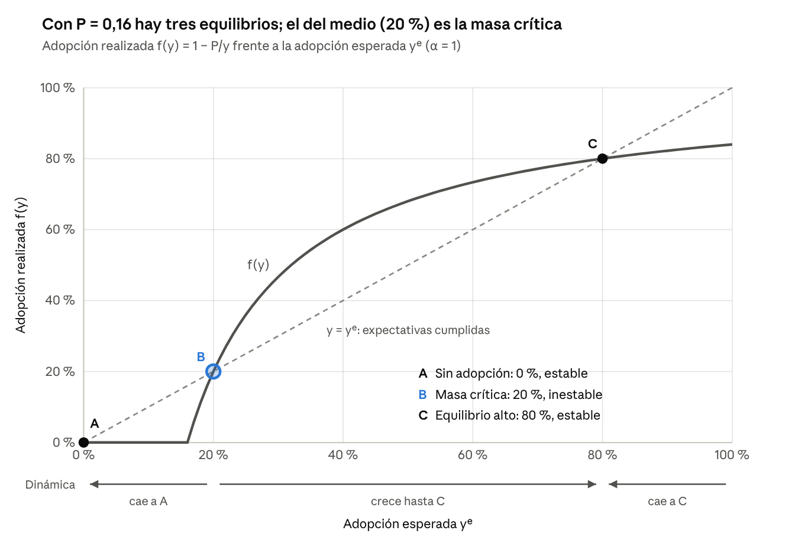
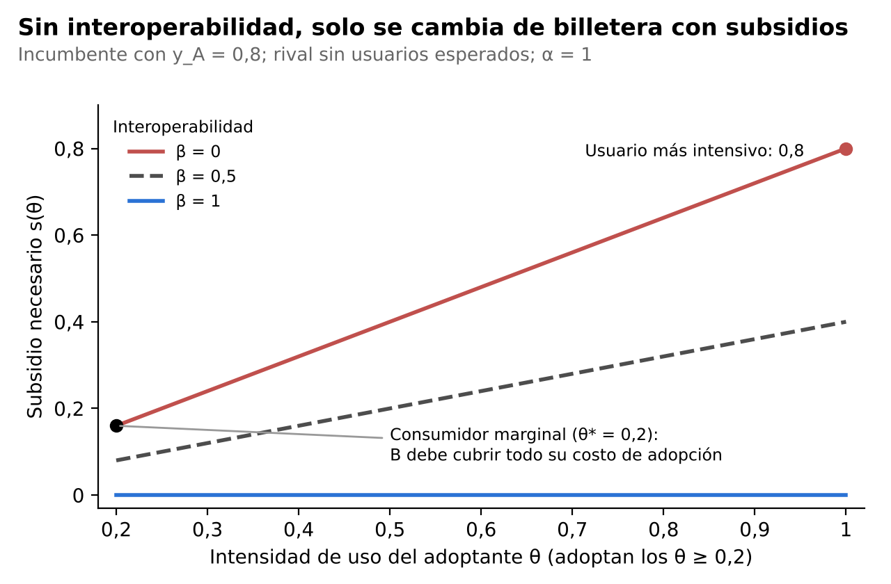

::: {custom-style="Title"}
Efectos de red, masa crítica y guerra de subsidios: por qué la interoperabilidad regulada superó a la libre competencia en las billeteras virtuales argentinas
:::

::: {custom-style="Subtitle"}
Universidad Argentina de la Empresa (UADE) · Facultad de Ciencias Económicas\
Organización Industrial (1.4.068) · 2.º cuatrimestre de 2026\
Trabajo Práctico N.º 6 · Grupo 6: [completar integrantes]\
Docente: Mg. Fernando Sotero · Noviembre de 2026
:::

**Resumen.** Mercado Pago y MODO compiten en un mercado con efectos de red, en el que el valor de una billetera depende de cuántos usuarios y comercios la usan. Se pone a prueba la hipótesis de que la libre competencia entre billeteras de acceso gratuito basta para alcanzar la adopción alta y el máximo bienestar. Con el modelo de expectativas autocumplidas (α = 1, P = 0,16) se obtiene una masa crítica de 20 % y un equilibrio alto de 80 %, en el que el consumidor marginal no gana nada con adoptar ni con cambiarse. Sin interoperabilidad, un rival solo capta usuarios con subsidios de hasta 0,8 por usuario, y la competencia degenera en una guerra de subsidios que no amplía la red. La hipótesis se rechaza. Los motivos son conceptuales (efectos de red, precio cero, productos no homogéneos) y regulatorios (figuras distintas ante el BCRA, interoperabilidad impuesta por etapas). **Palabras clave:** efectos de red, masa crítica, interoperabilidad, subsidios, billeteras virtuales.

# 1. Introducción: masa crítica y un equilibrio bajo para el consumidor

Una billetera virtual vale para el usuario en la medida en que la aceptan los comercios y la usan sus contactos. Por eso cada consumidor decide según lo que *espera* que hagan los demás. Si nadie espera que se use, nadie la adopta: el mercado queda en un equilibrio bajo aunque exista otro mejor para todos. Para salir de él hace falta superar una **masa crítica** de adoptantes. Una vez superada, el problema cambia: el consumidor queda atado a la red que eligió, porque cambiarse implica perder el valor de esa red. El consumidor marginal, que es el indiferente entre adoptar o no, no tiene nada que ganar.

En Argentina compiten Mercado Pago, que llegó primero y está integrado al ecosistema de Mercado Libre, y MODO, lanzada en 2020 por un grupo de bancos. Ambas son gratuitas para el usuario, de modo que no pueden competir bajando el precio: compiten con reintegros y promociones. En paralelo, el BCRA impuso por etapas la interoperabilidad de los pagos con QR desde 2021.

**Pregunta de investigación.** ¿Alcanza la libre competencia entre billeteras para llevar al mercado al equilibrio de alta adopción con el máximo bienestar, o fue necesaria la intervención estatal?

**Hipótesis general.** *La libre competencia entre billeteras virtuales de acceso gratuito basta, sin intervención estatal, para llevar al mercado al equilibrio de alta adopción con el máximo bienestar.*

**Objetivo general:** contrastar esta hipótesis con el modelo de demanda de red y con la evidencia argentina. **Objetivos específicos:** (i) calcular la masa crítica y el equilibrio del consumidor; (ii) medir el incentivo del consumidor a cambiarse de billetera y el subsidio que necesita un rival; (iii) comparar el bienestar con y sin interoperabilidad; (iv) identificar los motivos conceptuales y regulatorios por los que el resultado se aparta de la hipótesis.

Tras el estado del arte (sección 2) y la metodología (3), se presentan los cálculos (4), el contraste de la hipótesis (5) y las conclusiones (6).

# 2. Estado del arte: efectos de red

**Externalidades de red y expectativas.** Katz y Shapiro (1985) definen la externalidad de red como el beneficio de adoptar un bien que depende positivamente del número de otros adoptantes. En su modelo, la disposición a pagar de cada consumidor es su valoración intrínseca más un valor creciente en el tamaño *esperado* de la red. Los consumidores forman expectativas antes de que las firmas produzcan, y en equilibrio esas expectativas se cumplen (equilibrio de expectativas autocumplidas). Con redes incompatibles pueden existir equilibrios asimétricos, en los que una firma domina solo porque los consumidores esperan que domine. Además, las firmas con grandes redes tienden a oponerse a la compatibilidad aunque aumente el bienestar, y las pequeñas a favorecerla. Pepall, Richards y Norman (2006, cap. 22) presentan la versión de manual que usa este trabajo, con una masa crítica como equilibrio inestable.

**Mercados de dos lados.** Rochet y Tirole (2003) estudian las plataformas que atienden a dos grupos con externalidades cruzadas, como usuarios y comercios. En ellas importa la *estructura* de precios (cómo se reparte el precio total entre los lados), no solo su nivel. La regla es cobrar menos, o subsidiar, al lado cuya presencia más valora el otro. Esto explica por qué las billeteras son gratuitas, e incluso pagan reintegros, para el usuario: el usuario es el lado "difícil", y su presencia es lo que atrae a los comercios.

**Interconexión.** Crémer, Rey y Tirole (2000) extienden el modelo de Katz y Shapiro a redes que compiten y deciden la calidad de su interconexión, γ. Esa calidad la fija la red que menos la valora. La red más grande prefiere una interconexión de peor calidad que la pequeña, y la prefiere peor cuanto mayor es su ventaja de base instalada. El resultado se mantiene si los clientes usan varias redes: el rival pequeño no puede defenderse solo. Como esa calidad es menor que la socialmente óptima, la autoridad debe impedir que la red dominante fragmente el mercado.

Las tres contribuciones apuntan a que un mercado de red librado a sí mismo puede quedar trabado, concentrarse y resistir la compatibilidad. La hipótesis de este trabajo plantea lo contrario, la eficiencia de la libre competencia, para contrastarla con un caso concreto.

# 3. Metodología

Se usa el modelo del enunciado. La utilidad de adoptar para el consumidor de tipo θ es

::: {custom-style="Ecuacion"}
U = θ · (α · yᵉ) − P,   con θ ~ U[0,1], α = 1 y P = 0,16,
:::

donde θ es la intensidad de uso, yᵉ el tamaño esperado de la red, α la intensidad de la externalidad y P el costo efectivo de adopción. Como las billeteras son gratuitas, P se interpreta como un costo no monetario: alta, validación de identidad, aprendizaje, confianza. Para analizar la competencia se agregan dos billeteras, A (incumbente) y B (rival). La utilidad de usar la billetera i es U_i = θ·α·(y_iᵉ + β·y_jᵉ) − P_i, donde β ∈ [0,1] es el grado de interoperabilidad, equivalente a la calidad de interconexión γ de Crémer, Rey y Tirole. El bienestar neto es W(y) = α·y²(2 − y)/2 − P·y.

Se calculan equilibrios, estabilidad, incentivos a cambiarse y bienestar. La evidencia argentina proviene de comunicaciones e informes del BCRA, y de cifras de empresas y prensa identificadas como tales. Como P = 0,16 es hipotético, la evidencia se usa para contrastar mecanismos, no para calibrar el modelo.

# 4. Cálculos: qué tan bajo queda el consumidor

## 4.1 Masa crítica y equilibrios

El consumidor indiferente cumple U = 0, de modo que θ* = P/(α·yᵉ) = 0,16/yᵉ. La adopción realizada es y = 1 − 0,16/yᵉ; si se espera menos de 16 %, nadie adopta. Con expectativas autocumplidas (yᵉ = y):

::: {custom-style="Ecuacion"}
y² − y + P/α = 0   ⇒   y = [1 ± √(1 − 4P/α)] / 2 = (1 ± 0,6) / 2   ⇒   y_L = 0,2  y  y_H = 0,8.
:::

Junto con y = 0 hay tres equilibrios. La pendiente de la respuesta f(y) = 1 − P/(α·y) vale 4 en 0,2, que es por lo tanto inestable, y 0,25 en 0,8, que es estable (Gráfico 1). La masa crítica es 20 %: por debajo la red colapsa, y por encima crece sola hasta 80 %.

{width=7.5cm}

## 4.2 El consumidor marginal y el incentivo a cambiarse

En el equilibrio alto adoptan los θ ≥ 0,2. El consumidor marginal (θ* = 0,2) obtiene U = 0,2 · 0,8 − 0,16 = 0: no gana nada con estar en la red. Los inframarginales sí ganan: el excedente total de los usuarios es 0,256.

Si A tiene y_A = 0,8 y nadie espera usuarios en B, el usuario θ solo se cambia si B le ofrece un subsidio que cubra el valor de red que pierde:

::: {custom-style="Ecuacion"}
s(θ) = θ · α · (1 − β) · (y_A − y_Bᵉ) = 0,8 · θ · (1 − β).
:::

: Tabla 1. Subsidio que necesita B para que se cambie cada tipo de usuario. Elaboración propia.

| Interoperabilidad | Marginal (θ = 0,2) | Promedio (θ = 0,6) | Más intensivo (θ = 1) | Costo total, subsidio uniforme |
|---|---|---|---|---|
| β = 0 | 0,16 | 0,48 | 0,80 | 0,64 |
| β = 0,5 | 0,08 | 0,24 | 0,40 | 0,32 |
| β = 1 | 0 | 0 | 0 | 0 |

Sin interoperabilidad, para captar siquiera al consumidor marginal B debe cubrir todo su costo de adopción (0,16). Para captar a los demás debe pagar más, cuanto más intensivo es el usuario (Gráfico 2). Los usuarios que más valor aportan son los más difíciles de mover: **el incentivo a cambiarse es nulo sin subsidios**. Con interoperabilidad plena el valor de red ya no depende de la billetera, y el subsidio necesario desaparece.

{width=7.5cm}

## 4.3 La guerra de subsidios

Como las billeteras son gratuitas, el precio al usuario ya es cero y no puede bajar más: la competencia se traslada a los subsidios (reintegros, promociones, beneficios). Captar a todos los usuarios de A con un subsidio uniforme cuesta 0,8 × 0,8 = 0,64. Aun discriminando por tipo costaría 0,384, todo el valor bruto de la red. Ese gasto no crea red: si B tuviera éxito, el resultado sería el mismo equilibrio de 80 % con otro dueño. Además, sin interoperabilidad dos billeteras no pueden repartirse el mercado. Un reparto simétrico exige 2y² − y + P/[α(1 + β)] = 0, que con P = 0,16 solo tiene solución si β ≥ 0,28. Con redes incompatibles, la mitad del mercado no alcanza para sostener una red, y el mercado se inclina hacia una sola billetera.

## 4.4 Bienestar con y sin intervención

La interoperabilidad amplía la red de cada usuario (puede pagar en más comercios aunque su billetera sea chica), lo que en el modelo equivale a un aumento de α.

: Tabla 2. Masa crítica, adopción y bienestar según el escenario. Elaboración propia, P = 0,16.

| Escenario | Masa crítica | Adopción | Bienestar W | % del óptimo con ese α |
|---|---|---|---|---|
| Sin intervención, trampa | — | 0 | 0 | 0 % |
| Sin intervención, equilibrio alto (α = 1) | 20 % | 80 % | 0,256 | 75,3 % |
| Interoperabilidad parcial (α = 1,25) | 15,1 % | 84,9 % | 0,383 | 82,3 % |
| Interoperabilidad plena (α = 1,5) | 12,1 % | 87,9 % | 0,509 | 86,2 % |

Con interoperabilidad la masa crítica baja, la adopción sube y el bienestar casi se duplica (de 0,256 a 0,509). En todos los casos queda una brecha con el óptimo: el consumidor marginal no internaliza el beneficio que su adopción genera en los demás, así que hay sub-adopción.

# 5. Contraste de la hipótesis: por qué no se cumple

## 5.1 Resultado

La hipótesis se rechaza por tres motivos que surgen de los cálculos. Primero, la libre competencia no garantiza salir de la trampa: si la adopción esperada no supera 20 %, el mercado se queda en cero. Segundo, aun en el equilibrio alto hay sub-adopción, porque el consumidor marginal no gana nada y no internaliza la externalidad. Tercero, la competencia no disciplina al incumbente: sin interoperabilidad los usuarios no se cambian, el rival solo puede pagar subsidios que no crean red y el mercado no puede repartirse.

## 5.2 Razones conceptuales

**Efectos de red y *lock-in*.** El valor está en la red, no en el producto. El usuario que se cambia pierde el valor de su red, y por eso el incentivo a migrar es nulo sin subsidios (Tabla 1). Es el resultado de Katz y Shapiro (1985): una firma puede dominar porque los consumidores esperan que domine.

**Ingreso gratuito y guerra de subsidios.** Como el precio al usuario es cero, la regla de Rochet y Tirole (2003) se lleva al extremo: el lado de los usuarios se subsidia y se recauda del otro lado o de otros servicios. Las promociones y reintegros de los bancos a través de MODO y el ecosistema de crédito e inversiones de Mercado Pago son formas de ese subsidio (MODO, s.f.-b; Mercado Libre, 2026).

**Productos no homogéneos.** La hipótesis supone, implícitamente, que las billeteras son sustitutos que compiten como en un Bertrand con producto homogéneo. No lo son. Mercado Pago opera con cuentas de pago propias, integradas a un *marketplace*, crédito e inversiones. MODO se usa desde la aplicación de cada banco y paga con las cuentas y tarjetas bancarias del usuario (MODO, s.f.-a). Con productos diferenciados, la competencia en precios no lleva al resultado eficiente, y aun con interoperabilidad las billeteras no son sustitutos perfectos.

## 5.3 Razones burocráticas y regulatorias

**Figuras regulatorias distintas.** El BCRA distingue al proveedor de servicios de pago que ofrece cuentas de pago (PSPCP) del que solo inicia pagos sin proveer cuentas (PSI) (BCRA, s.f.). Mercado Pago ofrece cuentas de pago propias. MODO es un producto de Play Digital S.A., constituida en 2020 por BBVA, Galicia y Santander, cuyo objeto social excluye la actividad financiera (Boletín Oficial, 2020); su operatoria se asemeja a la iniciación de pagos. La categoría exacta de cada una debe confirmarse en el Registro del BCRA. Lo relevante es que operan bajo reglas y nombres distintos, lo que refuerza que no son productos homogéneos.

**Interoperabilidad impuesta por etapas.** La compatibilidad no surgió del mercado: se impuso norma por norma (Tabla 3), con postergaciones.

: Tabla 3. Secuencia normativa de la interoperabilidad de pagos con QR. Elaboración propia con base en BCRA (2021, 2022, 2023, 2024).

| Fecha | Norma | Contenido |
|---|---|---|
| Nov. 2021 | Transferencias 3.0 (Com. A 7175) | QR interoperable para pagos con transferencia |
| Feb. 2022 | Com. A 7462 | Registro de billeteras; todo QR debe poder leerse por todas las billeteras inscriptas |
| May. 2023 – abr. 2024 | Com. A 7769 y prórrogas | Pago con crédito desde cualquier billetera, sin diferencias de comisión ni de plazo; postergada dos veces |
| May. 2024 | Com. A 8032 | Toda billetera debe leer cualquier QR; tope de 0,07 % a la comisión entre billetera y emisora |

**Interconexión asimétrica.** Según la prensa, antes de la A 8032 desde Mercado Pago se podía pagar con crédito leyendo QR de otras billeteras, pero desde MODO un QR de Mercado Pago solo admitía débito (El Cronista, 2024a). Sería una interconexión parcial y asimétrica (γ < 1), como predicen Crémer, Rey y Tirole (2000). No hay verificación independiente de ese hecho.

**Conflicto sin resolver.** En 2024 MODO y los bancos denunciaron a Mercado Pago ante la Comisión Nacional de Defensa de la Competencia por abuso de posición dominante, y Mercado Libre denunció a los bancos de MODO por presunta cartelización (El Cronista, 2024b, 2024c). No hay resolución pública.

## 5.4 El papel de la intervención estatal

La regulación funcionó como un piso a la calidad de interconexión: obligó a que todo QR pueda leerse desde cualquier billetera y prohibió diferencias de comisión y plazo según la billetera. La evidencia es consistente con el modelo. Los pagos con transferencia iniciados con QR pasaron de unas 46.800 operaciones diarias en enero de 2022 a unas 253.000 un año después (BCRA, 2023). En agosto de 2026 hubo 118,3 millones de pagos con transferencia, 65,6 % más que un año antes, y el 99,1 % se inició con QR (BCRA, 2026b). En cambio, el QR con tarjeta de crédito, interoperable recién desde 2024, era en julio de 2026 el 4,6 % de las operaciones con crédito (BCRA, 2026a): es lo esperable en un segmento que todavía no superó su masa crítica. Son asociaciones, no relaciones causales.

# 6. Conclusiones

El trabajo contrastó la hipótesis de que la libre competencia entre billeteras gratuitas basta para alcanzar la adopción alta y el máximo bienestar. Los cálculos muestran que el mercado necesita superar una masa crítica de 20 % y que, una vez en el equilibrio alto de 80 %, el consumidor marginal no gana nada con estar ni con cambiarse. Sin interoperabilidad, un rival solo capta usuarios con subsidios de hasta 0,8 por usuario, y el mercado no puede repartirse entre dos billeteras.

La hipótesis se rechaza. Los motivos son conceptuales: los efectos de red atan al consumidor, el precio cero traslada la competencia a una guerra de subsidios que no crea red y las billeteras no son productos homogéneos. Y son también regulatorios: las billeteras operan bajo figuras distintas, la interoperabilidad se impuso por etapas y con postergaciones, y el conflicto entre las partes sigue abierto. En este caso, la intervención del BCRA, al fijar un piso a la interoperabilidad, bajó la masa crítica y elevó el bienestar en el modelo de 0,256 a 0,509. La libre competencia, por sí sola, no lo habría logrado.

Las limitaciones son que P = 0,16 es hipotético, que la masa crítica no es observable, que el modelo supone un solo lado y una billetera por usuario, y que no hay datos oficiales de participación por billetera. Como trabajo futuro se propone estimar el efecto de cada comunicación del BCRA con un diseño de diferencias en diferencias.

# Bibliografía

**Artículos académicos**

CRÉMER, J., REY, P., TIROLE, J., (2000). "Connectivity in the commercial Internet", *The Journal of Industrial Economics*, Vol. 48, N°4, pp. 433-472.

KATZ, M. L., SHAPIRO, C., (1985). "Network externalities, competition, and compatibility", *The American Economic Review*, Vol. 75, N°3, pp. 424-440.

ROCHET, J.-C., TIROLE, J., (2003). "Platform competition in two-sided markets", *Journal of the European Economic Association*, Vol. 1, N°4, pp. 990-1029.

**Libro de la cátedra**

PEPALL, L., RICHARDS, D. J., NORMAN, G., (2006). "Organización industrial: teoría y práctica contemporáneas", cap. 22, Thomson. [Verificar edición.]

**Fuentes documentales del caso argentino**

BCRA (s.f.). *Glosario de Pagos Minoristas*; (2021). "Interoperability between electronic wallets and acceptors was successful in 3.0 Transfers launch", 29/11/2021. www.bcra.gob.ar

BCRA (2022, 2023, 2024). Comunicaciones "A" 7462 (24/2/2022), 7769 (18/5/2023) y 8032 (30/5/2024); y "Uno de cada cuatro pagos con transferencia se inicia a través del código QR" (18/2/2023). www.bcra.gob.ar

BCRA (2026a, 2026b). *Informe Mensual de Pagos Minoristas*, julio y agosto de 2026. www.bcra.gob.ar

BOLETÍN OFICIAL (1/6/2020). Play Digital S.A., constitución (Escritura N° 108 del 26/5/2020). www.boletinoficial.gob.ar

EL CRONISTA (2024a, 7/5/2024). "También firmas que instrumentan pagos piden que se abra el mercado de tarjetas de crédito y QR"; (2024b, 29/5/2024). "Mercado Pago y MODO firmaron un acuerdo para poder usar tarjetas con los QR"; (2024c, 26/8/2024). "Mercado Pago vs. MODO: la denuncia que sacude al ecosistema de pagos digitales". www.cronista.com

MERCADO LIBRE (2026). *Second Quarter 2026 Financial Results*. news.mercadolibre.com

MODO (s.f.-a). "Qué es MODO"; (s.f.-b). "Promociones con MODO" (sitio de la empresa). www.modo.com.ar
