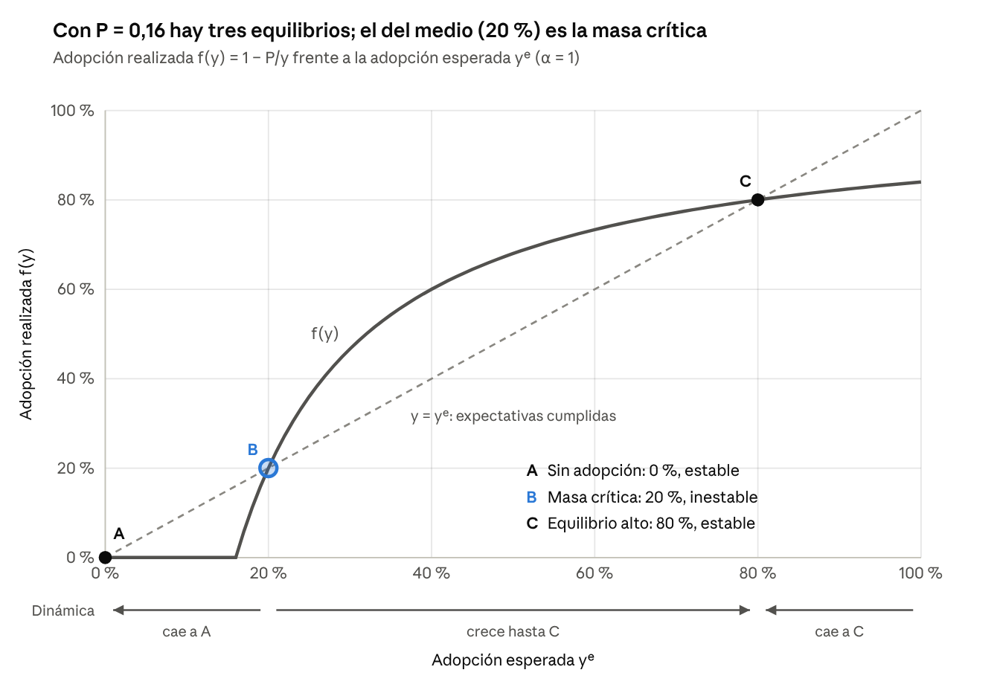
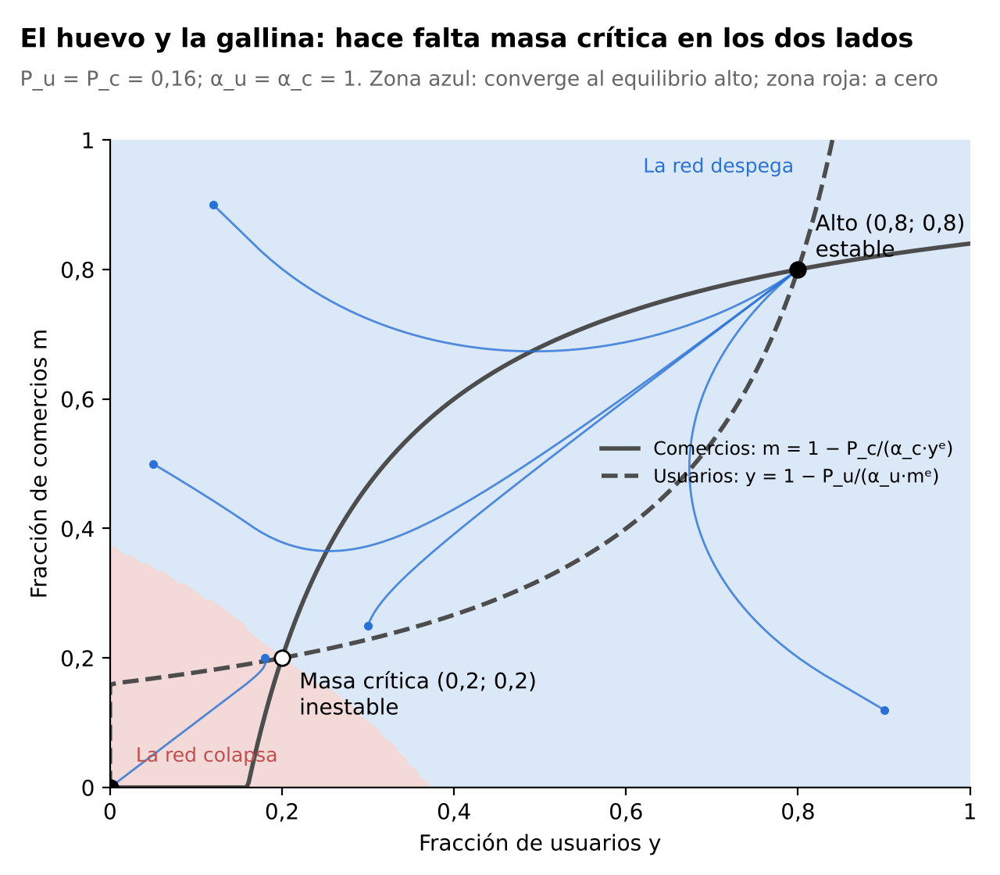

::: {custom-style="Title"}
Masa crítica e interoperabilidad: por qué la regulación, y no la competencia espontánea, sostiene la adopción de billeteras virtuales en Argentina
:::

::: {custom-style="Subtitle"}
Universidad Argentina de la Empresa (UADE) · Facultad de Ciencias Económicas\
Organización Industrial (1.4.068) · 2.º cuatrimestre de 2026\
Trabajo Práctico N.º 6 · Grupo 6: [completar integrantes]\
Docente: Mg. Fernando Sotero · Octubre de 2026
:::

**Resumen.** Las billeteras virtuales compiten en un mercado con efectos de red. Con el modelo de expectativas autocumplidas de Katz y Shapiro (1985), con α = 1 y P = 0,16, se obtienen tres equilibrios: sin adopción (estable), una masa crítica de 20 % (inestable) y una adopción alta de 80 % (estable). El modelo se extiende a un mercado de dos lados (Rochet y Tirole, 2003) y a la competencia entre dos plataformas con distintos grados de interoperabilidad (Crémer, Rey y Tirole, 2000). Sin interoperabilidad el mercado se inclina hacia una sola billetera; con interoperabilidad plena el bienestar es máximo, pero la plataforma dominante la resiste. La secuencia normativa del BCRA desde 2021 y la evolución de los pagos con QR son consistentes con esta hipótesis. **Palabras clave:** efectos de red, masa crítica, mercados de dos lados, interoperabilidad.

# 1. Introducción

Los pagos con billeteras virtuales, como Mercado Pago y MODO, se expandieron con rapidez en Argentina, pero su adopción no se explica solo por el precio: una billetera vale para un usuario en la medida en que la aceptan los comercios y la usan sus contactos, y vale para un comercio en la medida en que la usan sus clientes. Este efecto de red hace que la adopción dependa de lo que cada uno *espera* que hagan los demás, genera equilibrios múltiples y puede dejar al mercado atrapado en un equilibrio de baja adopción aunque exista otro mejor para todos.

**Pregunta de investigación.** ¿Por qué un mercado de pagos digitales con efectos de red puede quedar atrapado en un equilibrio de baja adopción, o en la red de la plataforma que llegó primero, y qué mecanismo permite llevarlo al equilibrio de alta adopción y sostenerlo allí?

**Hipótesis general.** *La adopción de billeteras virtuales es un problema de coordinación con masa crítica, y el mecanismo que permite alcanzar y sostener el equilibrio de alta adopción es la interoperabilidad impuesta por regulación: amplía la red efectiva de cada usuario, reduce la masa crítica y elimina la ventaja de red que lleva a la plataforma dominante a resistir la compatibilidad.*

**Objetivo general:** explicar la dinámica de adopción de las billeteras virtuales con el modelo de demanda de red y evaluar el papel de la interoperabilidad. **Objetivos específicos:** (i) derivar los equilibrios, su estabilidad y la masa crítica del modelo del enunciado; (ii) evaluar cómo el subsidio, el precio de monopolio, la estructura de precios entre usuarios y comercios y la interoperabilidad modifican la masa crítica; (iii) contrastar las predicciones con la evolución de los pagos con QR en Argentina.

El tema es relevante porque los mercados de pagos se concentran con facilidad y su regulación está en discusión en el país. Tras el estado del arte (sección 2) y la metodología (3), se presentan los resultados (4), su contraste con el caso argentino (5) y las conclusiones (6).

# 2. Estado del arte

**Externalidades de red y compatibilidad.** Katz y Shapiro (1985) formalizan la idea de que el beneficio de adoptar un bien crece con el número de adoptantes. Como el consumidor decide antes de saber cuántos adoptarán, introducen el *equilibrio de expectativas autocumplidas* (EEA), en el que las expectativas sobre el tamaño de la red se verifican. Esto genera equilibrios múltiples y un umbral de adopción o masa crítica, que Pepall, Richards y Norman (2006, cap. 22) presentan con la demanda de red p(n) = n(1 − n). Katz y Shapiro muestran además que los incentivos privados y sociales a la compatibilidad divergen: la compatibilidad amplía la red de cada consumidor, pero reduce la ventaja de las firmas con mayor base instalada, que por eso tienden a preferir la incompatibilidad.

**Mercados de dos lados.** Rochet y Tirole (2003) caracterizan a las plataformas que atienden a dos grupos con externalidades cruzadas, como usuarios y comercios. Un mercado es de dos lados cuando la plataforma puede alterar el volumen de transacciones cambiando la *estructura* de precios, es decir, cómo reparte el precio total entre los lados, y no solo su nivel. La regla resultante es cobrar menos, o subsidiar, al lado cuya presencia más valora el otro, como hacen las tarjetas de crédito al bonificar al titular y cobrar al comercio. Así se formaliza el problema del huevo y la gallina.

**Interconexión.** Crémer, Rey y Tirole (2000) extienden el modelo de Katz y Shapiro a redes que compiten y deciden si interconectarse. La red más grande tiene incentivos a ofrecer a sus rivales una interconexión de peor calidad que la que ofrecería una red pequeña, y el resultado se mantiene aun si los clientes usan varias redes. La compatibilidad, entonces, no surge espontáneamente cuando hay una red dominante.

En conjunto, la literatura predice que los mercados de red tienen umbrales de adopción, que la estructura de precios importa y que la red dominante resiste la compatibilidad. Este trabajo integra los tres aportes en un modelo y los aplica a los pagos con QR en Argentina.

# 3. Metodología

Se utiliza el modelo de forma reducida del enunciado. La utilidad de adoptar para el consumidor de tipo θ es

::: {custom-style="Ecuacion"}
U = θ · (α · yᵉ) − P,   con θ ~ U[0,1], α = 1 y P = 0,16,
:::

donde θ es la intensidad de uso, yᵉ el tamaño esperado de la red (fracción de adoptantes), α la intensidad de la externalidad y P el costo efectivo de adopción. Se supone una población normalizada en 1, expectativas autocumplidas en equilibrio (yᵉ = y) y un ajuste gradual de las expectativas fuera de él, que permite evaluar la estabilidad. Cuando una plataforma fija precios, se supone costo marginal nulo.

El análisis combina álgebra de equilibrio, estática comparativa, bienestar y simulación numérica, y se extiende a un modelo de dos lados y a la competencia entre dos billeteras con un grado de interoperabilidad β. La evidencia argentina proviene de comunicaciones e informes del BCRA, y de cifras de empresas y prensa identificadas como tales. Como P = 0,16 es un valor hipotético y la masa crítica no es observable, esa evidencia se usa para contrastar mecanismos de forma cualitativa, no para calibrar el modelo.

# 4. Resultados

## 4.1 Consumidor marginal, equilibrios y estabilidad

El consumidor indiferente cumple U = 0, de modo que

::: {custom-style="Ecuacion"}
θ* = P / (α · yᵉ) = 0,16 / yᵉ   ⇒   y = 1 − 0,16 / yᵉ si yᵉ > 0,16, e y = 0 en otro caso.
:::

Si se espera menos de 16 % de adopción, ni el usuario más intensivo adopta. Imponiendo yᵉ = y se obtiene y² − y + P/α = 0:

::: {custom-style="Ecuacion"}
y = [1 ± √(1 − 4P/α)] / 2 = (1 ± 0,6) / 2   ⇒   y_L = 0,2  y  y_H = 0,8,
:::

además del equilibrio sin adopción, y = 0. Un equilibrio es estable si la pendiente de la función de respuesta f(y) = 1 − P/(α·y) es menor que 1: f′(0,2) = 4 (inestable) y f′(0,8) = 0,25 (estable). El equilibrio intermedio es la **masa crítica**: si la adopción esperada supera 20 %, la red crece sola hasta 80 %; si no, colapsa a cero (Gráfico 1). La no adopción es una trampa de coordinación: nadie quiere ser el primero.

{width=9cm}

## 4.2 Qué mueve la masa crítica

La masa crítica es y_L = [1 − √(1 − 4P/α)] / 2: crece con P y cae con α. La Tabla 1 compara cuatro escenarios.

: Tabla 1. Masa crítica y equilibrio alto según el escenario. Elaboración propia.

| Escenario | P | α | Masa crítica | Equilibrio alto |
|---|---|---|---|---|
| Base | 0,16 | 1 | 20 % | 80 % |
| Subsidio temporal de 0,07 | 0,09 | 1 | 10 % | 90 % |
| Interoperabilidad (red efectiva mayor) | 0,16 | 1,5 | 12,1 % | 87,9 % |
| Precio de monopolio | 2/9 | 1 | 33,3 % | 66,7 % |

El **subsidio** baja P y sirve para cruzar el umbral; una vez superado, puede retirarse y la red sigue creciendo. La **interoperabilidad** actúa como un aumento de α, porque cada usuario accede a más comercios y usuarios aunque su billetera sea chica, y su efecto es permanente. El **monopolio** va en sentido contrario: una plataforma que maximiza π = P · y_H(P) elige P = 2/9, con y_H = 2/3 y π = 4/27 ≈ 0,148 (frente a 0,128 con P = 0,16), pero eleva la masa crítica a 1/3. Ese dilema explica los precios de penetración.

En términos de bienestar, W(y) = y²(2 − y)/2. Como el usuario marginal no internaliza el beneficio que su adopción genera en los demás, el mercado adopta menos que el óptimo social (y = 1, W = 0,5). Con el precio de monopolio, W = 8/27 ≈ 0,296: se pierde el 40,7 % del bienestar máximo.

## 4.3 Extensión bilateral: usuarios y comercios

Se separan usuarios (θ) y comercios (φ), ambos uniformes en [0,1], y cada lado valora el tamaño esperado del otro: U = θ·α_u·mᵉ − P_u y V = φ·α_c·yᵉ − P_c, donde m es la fracción de comercios. Con a = P_u/α_u y b = P_c/α_c, los equilibrios cumplen

::: {custom-style="Ecuacion"}
y² − (1 + b − a) · y + b = 0,   m = 1 − b/y,
:::

y son estables si √(a·b) < y·m. Con lados simétricos (P_u = P_c = 0,16, α_u = α_c = 1) se recuperan los equilibrios (0; 0), (0,2; 0,2) y (0,8; 0,8): **el modelo del enunciado es el caso simétrico del bilateral**. La masa crítica pasa a ser una frontera en el plano usuarios-comercios (Gráfico 2). Alcanza con 20 % de cada lado, pero si se parte sin comercios hacen falta alrededor de 37,5 % de usuarios.

{width=8.5cm}

La estructura de precios importa. Con el mismo precio total (0,32), pasar de cobrar 0,16 a cada lado a cobrar todo a los comercios eleva el volumen de transacciones y·m de 0,64 a 0,68. Si los comercios valoran más a los usuarios que al revés (α_c = 2, α_u = 1), la plataforma monopolista cobra P_u = 0 y P_c = 1, con y = 1 y m = 0,5. Es la regla de Rochet y Tirole (2003): la billetera es gratuita para el usuario y el comercio paga la comisión.

## 4.4 Competencia entre dos billeteras e interoperabilidad

Sean dos billeteras, A (incumbente) y B (rival), y consumidores que usan una sola. La utilidad de la billetera i es U_i = θ·α·(y_iᵉ + β·y_jᵉ) − P_i, donde β ∈ [0,1] es el grado de interoperabilidad. La ventaja de A sobre B es

::: {custom-style="Ecuacion"}
U_A − U_B = θ · α · (1 − β) · (y_Aᵉ − y_Bᵉ) − (P_A − P_B).
:::

De aquí surgen tres resultados. **Primero, sin interoperabilidad el mercado se inclina hacia una sola billetera.** En un reparto simétrico cada red cumple 2y² − y + P/[α(1 + β)] = 0, que con P = 0,16 solo tiene solución si β ≥ 0,28: con redes incompatibles, la mitad del mercado no alcanza para sostener una red. **Segundo, entrar contra un incumbente exige subsidios.** Si A tiene y_A = 0,8 y nadie espera usuarios en B, el usuario más intensivo se pasa a B solo si P_B ≤ 0,16 − 0,8·α·(1 − β). Con β = 0, B debe *pagar* 0,64 por usuario; con β = 1, le basta igualar el precio (Gráfico 3). **Tercero, con interoperabilidad plena la competencia es en precios.** La red es común y las billeteras compiten à la Bertrand hasta el costo marginal: P = 0, y = 1 y W = 0,5, frente a W ≈ 0,296 con una billetera dominante que cobra 2/9. Como el beneficio de la dominante cae de 0,148 a 0, la red grande resiste la interoperabilidad, tal como predicen Crémer, Rey y Tirole (2000).

{width=8.5cm}

# 5. Contraste con el caso argentino

En Argentina la interoperabilidad de los pagos con QR no surgió de la competencia, sino de una secuencia de decisiones del BCRA (Tabla 2).

: Tabla 2. Secuencia normativa de la interoperabilidad de pagos con QR. Elaboración propia con base en BCRA (2021, 2022, 2023, 2024).

| Fecha | Norma | Contenido |
|---|---|---|
| Nov. 2021 | Transferencias 3.0 (Com. A 7175) | QR interoperable para pagos con transferencia entre billeteras y cuentas bancarias |
| Feb. 2022 | Com. A 7462 | Registro de billeteras interoperables; un comercio no puede cobrar con un QR que no lean todas las billeteras inscriptas |
| May. 2023 – abr. 2024 | Com. A 7769 y prórrogas | Pago con tarjeta de crédito desde cualquier billetera, sin diferencias de comisión ni de plazo; vigente desde el 30/4/2024 tras dos postergaciones |
| May. 2024 | Com. A 8032 | Toda billetera debe leer cualquier QR; tope de 0,07 % a la comisión entre billetera y emisora |

La evidencia es consistente con las tres predicciones del modelo. **La adopción despega cuando aumenta la red efectiva:** los pagos con transferencia iniciados con QR pasaron de unas 46.800 operaciones diarias en enero de 2022 a unas 253.000 un año después (BCRA, 2023), y en agosto de 2026 hubo 118,3 millones de pagos con transferencia, 65,6 % más que un año antes, el 99,1 % iniciados con QR (BCRA, 2026b). Es la trayectoria esperada de un mercado que supera la masa crítica. **Los segmentos que se abrieron más tarde siguen por debajo del umbral:** el QR interoperable con tarjeta de crédito, vigente desde 2024, era en julio de 2026 apenas el 4,6 % de las operaciones con crédito (BCRA, 2026a), aunque también pueden influir el hábito o las promociones por tarjeta. **La plataforma dominante resistió la compatibilidad:** la interoperabilidad con crédito se postergó dos veces y, según la prensa, Mercado Pago resistió abrir su QR (Ámbito, 2024). En mayo de 2024 MODO y los bancos denunciaron a Mercado Pago ante la Comisión Nacional de Defensa de la Competencia por abuso de posición dominante, y en agosto Mercado Libre denunció a los bancos de MODO por presunta cartelización (El Cronista, 2024a, 2024b). Sin resolución pública, son alegaciones de parte, pero ilustran la predicción de Crémer, Rey y Tirole (2000). Como no hay una medición oficial de participación por billetera (las cifras son declaradas por las empresas; Mercado Libre, 2026), esta evidencia muestra asociaciones, no relaciones causales.

# 6. Conclusiones

El trabajo se preguntó por qué un mercado de pagos digitales puede quedar atrapado en un equilibrio de baja adopción y qué permite salir de él. Con P = 0,16 y α = 1 coexisten un equilibrio sin adopción y uno de 80 %, separados por una masa crítica de 20 %. En un mercado de dos lados esa masa crítica debe alcanzarse en ambos lados y la estructura de precios importa; entre plataformas competidoras, la falta de interoperabilidad inclina el mercado hacia una sola billetera y obliga a los entrantes a subsidiar fuertemente.

La hipótesis general no se rechaza. La interoperabilidad es el único instrumento analizado que reduce la masa crítica de forma permanente, elimina la ventaja de red del incumbente y lleva el bienestar a su máximo; a la vez, es justamente lo que la plataforma dominante no elegiría por sí misma. La experiencia argentina, en la que el BCRA debió imponer y extender la interoperabilidad mientras los pagos con QR crecían con fuerza, es consistente con esa conclusión.

Las principales limitaciones son que P = 0,16 es un valor hipotético, que la masa crítica no es observable, que el modelo supone que cada usuario usa una sola billetera y que la competencia à la Bertrand es un caso extremo, porque las billeteras se diferencian por sus servicios. Como trabajo futuro se propone estimar el efecto de cada comunicación del BCRA sobre la adopción con un diseño de diferencias en diferencias por segmento de pago, y calibrar α y P con encuestas de uso.

# Bibliografía

**Artículos académicos**

CRÉMER, J., REY, P., TIROLE, J., (2000). "Connectivity in the commercial Internet", *The Journal of Industrial Economics*, Vol. 48, N°4, pp. 433-472.

KATZ, M. L., SHAPIRO, C., (1985). "Network externalities, competition, and compatibility", *The American Economic Review*, Vol. 75, N°3, pp. 424-440.

ROCHET, J.-C., TIROLE, J., (2003). "Platform competition in two-sided markets", *Journal of the European Economic Association*, Vol. 1, N°4, pp. 990-1029.

**Libro y material de cátedra**

PEPALL, L., RICHARDS, D. J., NORMAN, G., (2006). "Organización industrial: teoría y práctica contemporáneas", cap. 22, Thomson. [Verificar edición según el programa.]

UADE (2026). "Organización Industrial, Unidad 9: Economías de red", material de estudio, docente F. Sotero.

**Fuentes documentales del caso argentino**

ÁMBITO (31/5/2024). "Mercado Pago vs bancos: el BCRA dispuso la interoperabilidad de los pagos con QR". www.ambito.com

BCRA (2021). "Interoperability between electronic wallets and acceptors was successful in 3.0 Transfers launch", 29/11/2021. www.bcra.gob.ar

BCRA (2022). Comunicación "A" 7462, 24/2/2022. www.bcra.gob.ar/pdfs/comytexord/A7462.pdf

BCRA (2023). "Uno de cada cuatro pagos con transferencia se inicia a través del código QR", 18/2/2023; y Comunicación "A" 7769, 18/5/2023. www.bcra.gob.ar

BCRA (2024). Comunicación "A" 8032, 30/5/2024. www.bcra.gob.ar/archivos/Pdfs/comytexord/A8032.pdf

BCRA (2026a, 2026b). *Informe Mensual de Pagos Minoristas*, julio y agosto de 2026. www.bcra.gob.ar

EL CRONISTA (2024a, 29/5/2024). "Mercado Pago y MODO firmaron un acuerdo para poder usar tarjetas con los QR"; (2024b, 26/8/2024). "Mercado Pago vs. MODO: la denuncia que sacude al ecosistema de pagos digitales". www.cronista.com

MERCADO LIBRE (2026). *Second Quarter 2026 Financial Results* (cifras declaradas por la empresa). news.mercadolibre.com
