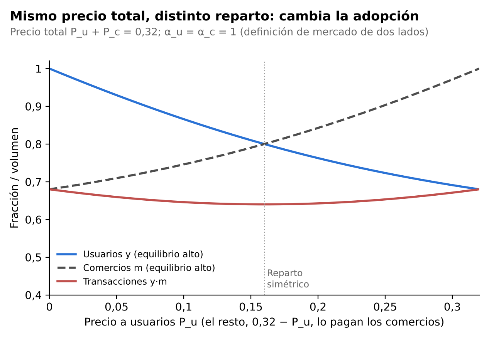
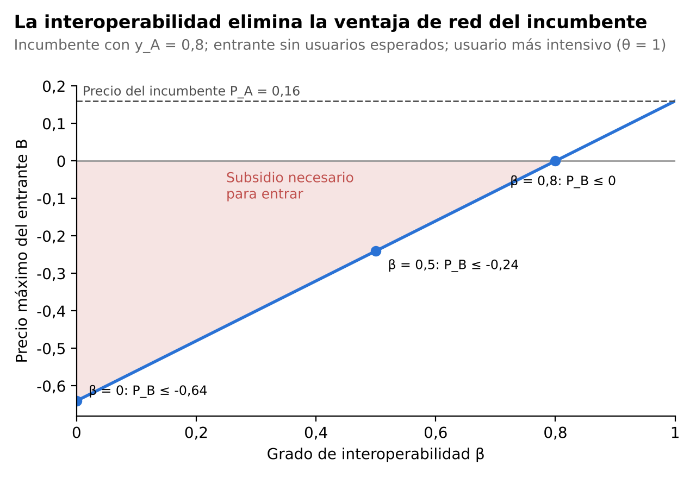

## 7. Extensiones: mercado bilateral y competencia entre dos plataformas

En la sección 4 se señaló una limitación del modelo base. El enunciado describe un mercado bilateral (usuarios y comercios), pero la ecuación U = θ · (α · yᵉ) − P resume todo en una única externalidad agregada. Esta sección levanta esa simplificación en dos direcciones complementarias:

- **7.1** separa usuarios y comercios dentro de una misma plataforma (extensión bilateral).
- **7.2** mantiene un solo lado, pero introduce dos billeteras que compiten entre sí (competencia entre plataformas).

Se conservan los supuestos de las secciones 5 y 6: tipos uniformes en [0,1], expectativas autocumplidas y costo marginal nulo para la plataforma.

### 7.1 Extensión bilateral: usuarios y comercios

**Planteo.** Los usuarios tienen un tipo θ ~ U[0,1] (intensidad de uso) y los comercios un tipo φ ~ U[0,1] (intensidad de ventas que se cobran con medios digitales). Cada lado valora el tamaño esperado **del otro lado**: es un efecto de red indirecto o cruzado (Rochet y Tirole, 2003; Armstrong, 2006).

**U = θ · (α_u · mᵉ) − P_u** (usuarios)

**V = φ · (α_c · yᵉ) − P_c** (comercios)

Aquí y es la fracción de usuarios que adoptan y m la fracción de comercios que aceptan la billetera. α_u mide cuánto valoran los usuarios cada comercio adherido y α_c cuánto valoran los comercios cada usuario. P_u y P_c son los costos efectivos de adopción de cada lado.

**Consumidores y comercios marginales.** Igual que en 5.1, adopta quien obtiene utilidad no negativa:

θ* = P_u / (α_u · mᵉ)  ⇒  y = 1 − P_u / (α_u · mᵉ)

φ* = P_c / (α_c · yᵉ)  ⇒  m = 1 − P_c / (α_c · yᵉ)

La adopción de cada lado depende de lo que se espera **del otro lado**. Este es el problema del huevo y la gallina: sin comercios no hay usuarios, y sin usuarios no hay comercios.

**Equilibrios.** Con expectativas autocumplidas en ambos lados (yᵉ = y, mᵉ = m), y llamando a = P_u/α_u y b = P_c/α_c, al reemplazar m en la ecuación de y se obtiene:

**y² − (1 + b − a) · y + b = 0,**  con  m = 1 − b / y

Además, siempre existe el equilibrio sin adopción (y = m = 0).

*Caso simétrico* (α_u = α_c = 1, P_u = P_c = 0,16). La ecuación se reduce a y² − y + 0,16 = 0, la misma de la sección 5.2. Los equilibrios son (0; 0), (0,2; 0,2) y (0,8; 0,8). **El modelo de un solo lado es, entonces, el caso simétrico del modelo bilateral**, lo que valida la forma reducida que usa el enunciado.

**Estabilidad.** Las expectativas se ajustan gradualmente hacia la adopción observada en cada lado. La matriz jacobiana del sistema es [[−1, a/m²], [b/y², −1]] y sus raíces son −1 ± √(ab)/(y·m). Un equilibrio es estable si

**√(a · b) < y · m**

Es la versión bilateral de la condición “pendiente menor que 1” de la sección 5.2: ahora lo que importa es el **producto de las respuestas cruzadas**.

| Equilibrio (y; m) | √(ab)/(y·m) | Estabilidad |
|---|---|---|
| (0; 0) | — | Estable |
| (0,2; 0,2) | 4 (> 1) | Inestable: punto de silla |
| (0,8; 0,8) | 0,25 (< 1) | Estable |

**Masa crítica en dos dimensiones.** La masa crítica ya no es un número, sino una **frontera** en el plano (y; m) que pasa por el punto de silla (0,2; 0,2). Por encima de esa frontera la red despega; por debajo, colapsa (Gráfico 4). Dos consecuencias:

- Alcanza con “sembrar” un solo lado si se lo siembra con fuerza. Con la dinámica de ajuste supuesta, si se parte sin comercios hacen falta alrededor del 37,5 % de usuarios para que la red despegue. Si se crece de forma equilibrada, alcanza con el 20 % de cada lado.
- Este resultado justifica estrategias como regalar terminales o QR a los comercios y, a la vez, dar reintegros a los usuarios.

*Gráfico 4. Diagrama de fases del modelo bilateral: curvas de respuesta de cada lado, equilibrios y zonas de atracción.*

Elaboración propia · P_u = P_c = 0,16; α_u = α_c = 1

**La estructura de precios importa.** La definición de Rochet y Tirole (2003) dice que un mercado es de dos lados si, **manteniendo fijo el precio total**, cambiar cómo se reparte entre los lados cambia el volumen de transacciones. El modelo lo verifica. Con P_u + P_c = 0,32 fijo:

| P_u | P_c | Equilibrio alto (y; m) | Masa crítica (y; m) | Transacciones y·m | Ingreso de la plataforma |
|---|---|---|---|---|---|
| 0,16 | 0,16 | (0,80; 0,80) | (0,20; 0,20) | 0,640 | 0,256 |
| 0,08 | 0,24 | (0,89; 0,73) | (0,27; 0,11) | 0,650 | 0,247 |
| 0,04 | 0,28 | (0,94; 0,70) | (0,30; 0,06) | 0,663 | 0,235 |
| 0,00 | 0,32 | (1,00; 0,68) | (0,32; 0) | 0,680 | 0,218 |

Con el mismo precio total, cargar más a los comercios eleva la adopción de usuarios y el volumen de transacciones (Gráfico 5). Cuando la billetera es gratis para el usuario (P_u = 0), basta que haya algunos comercios para que todos los usuarios adopten. La coordinación queda concentrada del lado de los comercios, que necesitan esperar al menos un 32 % de usuarios.

*Gráfico 5. Adopción y transacciones en el equilibrio alto según el reparto del precio total.*

Elaboración propia · P_u + P_c = 0,32; α_u = α_c = 1

**La plataforma monopolista elige la estructura.** Se extiende la sección 6 al caso bilateral. La plataforma, con costo marginal nulo, elige (P_u; P_c) para maximizar π = P_u · y + P_c · m en el equilibrio alto:

- *Lados simétricos* (α_u = α_c = 1): P_u = P_c = 2/9 ≈ 0,222, y = m = 2/3 y π = 8/27 ≈ 0,296. Es exactamente el doble del resultado de la sección 6, porque cada lado reproduce el monopolio de un lado. Sirve como control de consistencia.
- *Lados asimétricos* (α_u = 1, α_c = 2: cada usuario adicional le vale más al comercio, por las ventas que le trae, que cada comercio adicional al usuario): el óptimo es **P_u = 0 y P_c = 1**, con y = 1, m = 0,5 y π = 0,5. Con P_u = 0 todos los usuarios adoptan, de modo que los comercios enfrentan m = 1 − P_c/2 y la plataforma maximiza P_c · (1 − P_c/2).

Este último resultado es la regla de Rochet y Tirole vista en la Unidad 9: **se le cobra menos (incluso cero) al lado cuya presencia vale más para el otro y se recauda del lado que más se beneficia**. Es la estructura observada en las billeteras: la aplicación es gratuita y con reintegros para el usuario, y el comercio paga una comisión por cobro. Esa asimetría no implica por sí misma abuso de poder de mercado: es la forma eficiente de resolver el huevo y la gallina.

### 7.2 Competencia entre dos plataformas

**Planteo.** Hay dos billeteras, A (incumbente, por ejemplo Mercado Pago) y B (entrante o rival, por ejemplo MODO). Se vuelve al modelo de un lado. Cada consumidor usa a lo sumo una billetera (*single-homing*) y elige la que le da mayor utilidad, o ninguna:

**U_i = θ · α · (y_iᵉ + β · y_jᵉ) − P_i,**  i, j ∈ {A, B}

El parámetro **β ∈ [0,1] mide el grado de interoperabilidad**:

- β = 0: las redes son islas incompatibles; cada usuario solo aprovecha la red de su billetera.
- β = 1: interoperabilidad plena, como un QR que acepta cualquier billetera; la red relevante es la total.

**Ventaja de red.** La diferencia de utilidad entre las dos billeteras es:

**U_A − U_B = θ · α · (1 − β) · (y_Aᵉ − y_Bᵉ) − (P_A − P_B)**

La billetera más grande tiene una ventaja que crece con la diferencia de tamaño y con la intensidad del efecto de red, y **que la interoperabilidad reduce en la proporción (1 − β)**. Con β = 1 la ventaja desaparece y solo importa el precio.

**(a) Sin interoperabilidad, el mercado se inclina hacia una sola billetera (*tipping*).** Con β = 0 y precios iguales (P = 0,16), cada consumidor elige la red que espera más grande. Los equilibrios estables son:

- todos en A: (y_A; y_B) = (0,8; 0);
- todos en B: (0; 0,8);
- nadie adopta: (0; 0).

¿Podrían convivir con la mitad del mercado cada una? En un reparto simétrico y_A = y_B = y, cada red vale α(1 + β)y. Con la misma lógica de la sección 5:

**2y² − y + P/(α(1 + β)) = 0  ⇒  y = [1 ± √(1 − 8P/(α(1 + β)))] / 4**

| Interoperabilidad β | ¿Existe el reparto? | Cada billetera (equilibrio alto) | Masa crítica de cada una |
|---|---|---|---|
| 0 | **No** (1 − 8 × 0,16 < 0) | — | — |
| 0,28 | Justo en el límite | 0,25 | 0,25 |
| 0,5 | Sí | 0,35 | 0,15 |
| 1 | Sí | 0,40 (total 0,80) | 0,10 (total 0,20) |

Con redes incompatibles, **la mitad del mercado no alcanza para sostener una red**: cada mitad queda por debajo de su propia masa crítica. La coexistencia exige al menos β ≥ 8P/α − 1 = 0,28. Además, con β < 1 el reparto es frágil: si una billetera toma una ventaja mínima, la diferencia de utilidad favorece a la más grande y el mercado se inclina hacia ella. Solo la diferenciación de producto (Hotelling, Unidad 7) o el uso de varias billeteras a la vez (*multihoming*) pueden sostener la convivencia con baja interoperabilidad.

**(b) El costo de entrar contra un incumbente.** Se supone que A ya tiene y_A = 0,8 y cobra P_A = 0,16, y que nadie espera que B tenga usuarios (y_Bᵉ = 0). El usuario más intensivo (θ = 1) se pasa a B solo si:

**P_B ≤ 0,16 − 0,8 · α · (1 − β)**

| β | Precio máximo de B | Lectura |
|---|---|---|
| 0 | −0,64 | B debe *pagarle* al usuario 4 veces el costo de adopción |
| 0,5 | −0,24 | Sigue siendo necesario un subsidio |
| 0,8 | 0 | Alcanza con ser gratis |
| 1 | 0,16 | Basta igualar el precio del incumbente |

Sin interoperabilidad, “comprar” la red del incumbente cuesta, en el peor escenario de expectativas, alrededor de 0,64 × 0,8 ≈ 0,51. Una vez lograda la red, el beneficio por período es 0,16 × 0,8 = 0,128. Con un factor de descuento δ, la entrada es rentable solo si 0,128 · δ/(1 − δ) ≥ 0,51, es decir, si **δ ≥ 0,8**, y eso sin contar la reacción del incumbente. Esto explica las **guerras de subsidios** de la fase de captura de usuarios. También plantea la discusión de la Unidad 6: ¿precio de penetración o precio predatorio? (Gráfico 6).

*Gráfico 6. Precio máximo que puede cobrar un entrante según el grado de interoperabilidad.*

Elaboración propia · y_A = 0,8, y_Bᵉ = 0, P_A = 0,16, α = 1

**(c) Con interoperabilidad plena, la competencia pasa a ser “en el mercado”.** Con β = 1 la red es común y las billeteras son sustitutos perfectos en valor de red. Compiten à la Bertrand (Unidad 5) y el precio cae al costo marginal. Comparando con el caso sin interoperabilidad y con una billetera dominante que cobra el precio de monopolio de la sección 6 (costo marginal nulo):

| | Sin interoperabilidad, una billetera dominante | Interoperabilidad plena + Bertrand |
|---|---|---|
| Precio | 2/9 ≈ 0,222 | 0 (= costo marginal) |
| Adopción | 2/3 | 1 |
| Beneficio de la plataforma | 4/27 ≈ 0,148 | 0 |
| Excedente de los usuarios | 4/27 ≈ 0,148 | 1/2 = 0,5 |
| Bienestar total W = y²(2 − y)/2 | 8/27 ≈ 0,296 | 1/2 = 0,5 (máximo) |

Con costo marginal nulo, interoperabilidad y competencia en precios llevan al **óptimo social**. Si en cambio el 0,16 se interpreta como costo de adopción que la competencia no elimina (trámites, aprendizaje), el precio cae a ese nivel y la adopción total vuelve a 0,8, repartida entre las dos billeteras.

**(d) Incentivos: por qué la interoperabilidad suele requerir regulación.** La billetera dominante pierde con la interoperabilidad (su beneficio pasa de 0,148 a 0), mientras que los usuarios y el rival ganan. Es el resultado de Crémer, Rey y Tirole (2000): **la red grande prefiere no interconectarse**. Por eso la compatibilidad rara vez surge espontáneamente y suele imponerse por regulación, como en el caso del QR interoperable del BCRA (dato a verificar con la fuente oficial). En términos de la Unidad 8, negar la interoperabilidad funciona como una estrategia de **cierre de mercado (*foreclosure*)**.

Dos matices para la discusión:

- **Bertrand con producto homogéneo es un caso extremo.** Si las billeteras se diferencian (servicios financieros, integración con el *marketplace*, beneficios bancarios), conservan márgenes positivos aun con β = 1.
- **Interoperabilidad e innovación.** Obligar a la interoperabilidad reduce el premio del pionero que pagó el costo de alcanzar la masa crítica. Es la tensión entre competencia e innovación de la Unidad 10.

Sobre la colusión, un acuerdo de interoperabilidad entre rivales puede leerse de dos maneras (Unidad 6):

- **Procompetitivo:** baja la masa crítica y el *lock-in*.
- **Riesgoso:** si además coordina comisiones, atenúa la rivalidad.

El análisis debe separar la compatibilidad técnica, deseable, de la coordinación de precios, que no lo es.

### 7.3 Síntesis de las extensiones

| Resultado | Modelo base (secc. 5–6) | Extensión bilateral (7.1) | Competencia (7.2) |
|---|---|---|---|
| Masa crítica | 20 % de usuarios | Una frontera en (y; m): 20 % de cada lado, o 37,5 % de un solo lado | Cada billetera necesita su propia masa crítica; sin interoperabilidad el mercado no puede repartirse |
| Precio | Monopolio: 2/9 | La **estructura** importa: gratis para el lado más valioso | Sin interoperabilidad, subsidios para entrar; con interoperabilidad, precio igual al costo marginal |
| Política | Subsidio e interoperabilidad bajan la masa crítica | Subsidiar al lado “difícil” | La interoperabilidad elimina la ventaja de red (1 − β) y requiere regulación |
| Unidades | U2, U9 | U3 (estructura de precios), U9 (Rochet-Tirole) | U4 (coordinación), U5 (Bertrand), U6 (predación), U7, U8 (*foreclosure*), U10 |

*Referencias nuevas a incorporar a la bibliografía:* Armstrong (2006); Caillaud y Jullien (2003); Crémer, Rey y Tirole (2000); Rochet y Tirole (2003, 2006). Verificar los datos completos de cada una antes de citarlas.
